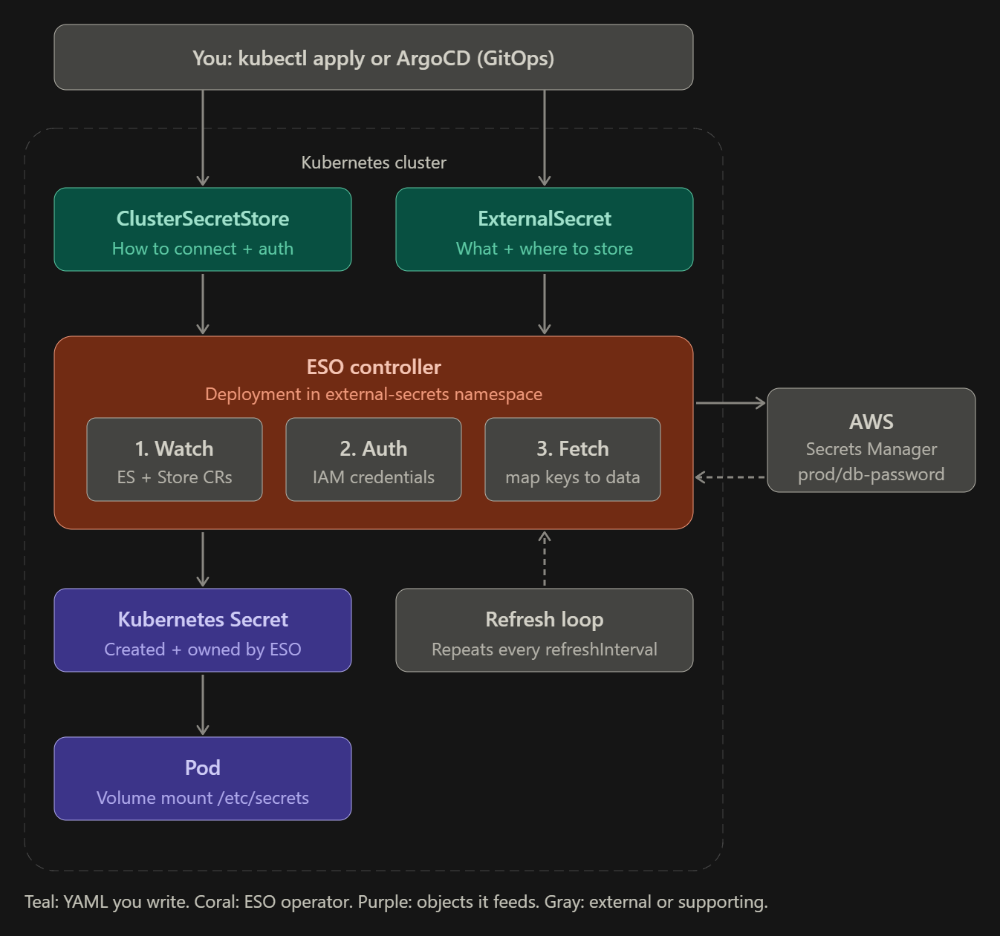

# external-secrets

## What I learned

### The problem
Plain Kubernetes Secrets are only base64, and their YAML must never go into Git. The real secret
lives in AWS Secrets Manager. External Secrets Operator (ESO) copies it into the cluster as a normal
Kubernetes Secret and keeps it in sync, so Git only holds a *reference*, never the value.

### The pieces
| Piece | Who creates it | Job |
|---|---|---|
| ESO controller | Installed once (Helm), runs in `external-secrets` namespace | Watches the CRs below, authenticates to AWS, fetches values, writes the Secret |
| SecretStore / ClusterSecretStore | Me (YAML) | HOW to connect + authenticate to AWS (provider, region, credentials). SecretStore = one namespace, ClusterSecretStore = whole cluster |
| ExternalSecret | Me (YAML) | WHAT to fetch (`remoteRef`) and WHERE to store it (`target.name`) |
| Kubernetes Secret | Created and owned by ESO | The normal Secret the Pod consumes |
| Pod | Me (YAML) | Mounts the Secret as files or env vars, knows nothing about AWS |

### Flow (block diagram)
```
AWS Secrets Manager
        |
        |  Remote secret: prod/db
        v
SecretStore / ClusterSecretStore
  └── AWS provider + IAM authentication
        |
        v
ExternalSecret
  └── remoteRef: prod/db
  └── target: db-secret
        |
        v
Kubernetes Secret: db-secret
  ├── username
  └── password
        |
        v
Application Pod
  └── Reads DB credentials
```

### Inside the cluster


Text version:
```
 You: kubectl apply / ArgoCD (GitOps)
        |                       |
        v                       v
 ClusterSecretStore        ExternalSecret
 (how to connect + auth)   (what + where to store)
        \                       /
         v                     v
        ESO controller  (Deployment, external-secrets ns)
          1. Watch  ExternalSecret + Store CRs
          2. Auth   IAM credentials
          3. Fetch  map AWS keys -> Secret data   <----> AWS Secrets Manager
                |                                         (prod/db-password)
                v
        Kubernetes Secret  (created + owned by ESO)
                |
                v
        Pod  (volume mount /etc/secrets)

 Refresh loop: ESO re-fetches every `refreshInterval`, so rotating the value in AWS
 updates the Secret automatically.
```

### The critical name links (typo = silent failure)
```
ExternalSecret.spec.secretStoreRef.name  ==  ClusterSecretStore.metadata.name
ExternalSecret.spec.target.name          ==  Pod.volumes.secret.secretName
```

## Key commands
(fill in after the hands-on)

## Practice YAMLs
- See .yaml files in this folder

## Gotchas / mistakes I made
(fill in after the hands-on)
