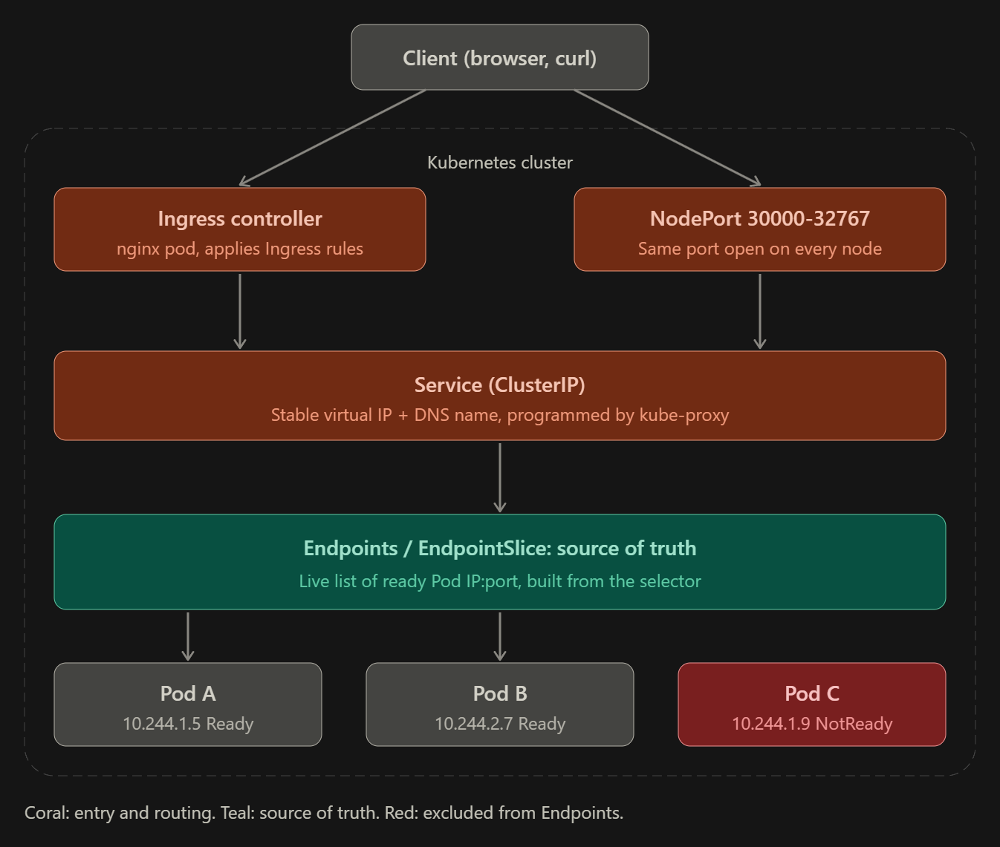

# services-ingress

## What I learned

### Flow diagram


```
 you (curl / browser)
        |
        |  Host: web.local
        v
 Ingress Controller (nginx pod, installed once - reads Ingress rules)
        |
        |  matches Ingress rule: host/path -> Service "web"
        v
 Service "web"  (ClusterIP 10.96.x.x, selector: app=web)
        |
        |  selector generates ->
        v
 Endpoints "web"  (real pod IPs: 10.244.0.35:80, .36:80, .37:80)
   <-- this is the ACTUAL source of truth kube-proxy reads to route traffic
        |
        |  kube-proxy load-balances across these
        v
 Pod: web-xxxxx-1     Pod: web-xxxxx-2     Pod: web-xxxxx-3
 (label: app=web)     (label: app=web)     (label: app=web)

 Service = the stable rule ("send to anything labeled app=web")
 Endpoints = the live list that rule currently resolves to
 Ingress = routes external traffic in; does nothing without the Controller
```

### Full picture: ClusterIP vs NodePort vs Ingress, Endpoints as source of truth
```
                                OUTSIDE THE CLUSTER
                                ====================
      laptop / browser                                   cloud LB (LoadBalancer type)
            |                                                    |
            | http://web.local (port 80/443)                     | (no-op/pending on bare KinD,
            v                                                    |  no cloud provider to ask)
    +-------------------------+                                  v
    |  Ingress Controller    |  <-- reads Ingress objects   (would point here on real cloud)
    |  (nginx pod)            |      (host/path rules)
    +-------------------------+
            |
            | Ingress rule: host "web.local" -> Service "web" port 80
            v
    =================================================================
                          INSIDE THE CLUSTER
    =================================================================

    ClusterIP "web"                        NodePort "web-np"
    10.96.27.135:80                        <any-node-ip>:30477 -> 80
    (reachable only                        (reachable from OUTSIDE too,
     from inside the cluster)               even with zero Ingress setup)
            \                                     /
             \                                   /
              \                                 /
               v                               v
           selector: app=web   (same selector, same pods - just two doors in)
                      |
                      | k8s continuously watches: which pods match this
                      | selector AND are passing their readiness probe?
                      v
            +-----------------------------+
            |   Endpoints "web"           |   <--- SOURCE OF TRUTH
            |   10.244.0.35:80            |        kube-proxy reads
            |   10.244.0.36:80            |        THIS LIST, never
            |   10.244.0.37:80            |        the selector directly
            +-----------------------------+
                      |
       kube-proxy programs iptables/IPVS rules straight from this list
                      |
        ------------------------------------------------
        |                    |                        |
        v                    v                        v
    Pod web-1            Pod web-2                Pod web-3
    app=web              app=web                  app=web
```

### Production analogy (company switchboard)
- **Pods** = individual employees at a desk. Each has a personal extension that changes every time they
  move desks (pod reschedules). Useless to hand that number to a customer.
- **Service** = the company's published support line ("1-800-WEB"). Never changes, customers memorize it.
- **Endpoints** = the switchboard's live routing table — which extensions are staffed and ready to take a
  call *right now*. The switchboard never re-derives this from scratch per call; it just reads this table.
  This is the thing that's actually "true" at any given moment, not the Service's selector rule.
- **ClusterIP** = an internal-extension-only number; only other employees (other pods) can dial it.
- **NodePort** = the same support line, but also manually patched through on literally every office
  branch's front desk phone on a fixed extension (30477) — any branch, any node, same switchboard behind it.
- **Ingress + Controller** = the actual receptionist standing at the building's main entrance holding a
  routing sheet ("visitor says 'Sales' -> walk them to extension X"). Without a receptionist physically
  there (the controller pod), that sheet (the Ingress YAML) is just a memo pinned to a wall. Does nothing.

### Debugging order (the actual sequence an SRE uses, cheapest check first)
1. Does the Service exist, right type, right port? `k get svc <name>`
2. **The critical check** - `k get endpoints <name>` (or `endpointslice`). Empty?
   - Empty -> selector/label mismatch, or pods failing readiness probe. Fixes ~80% of "Service is broken" tickets, instantly, for free.
   - Not empty -> keep going.
3. Are the pods themselves actually healthy? `k get pods -l <selector> -o wide`, `k describe pod`.
4. Bypass Ingress entirely - exec into any pod and `curl http://<service-name>:<port>` directly.
   Works here but fails from outside? -> problem is in the Ingress/controller layer, not the Service.
5. `k describe ingress <name>` - right host, right path, right backend service NAME and PORT
   (a typo'd service name in the Ingress is extremely common and gives no error, just 404s).
6. Is the controller itself alive and did it pick up the rule? `k get pods -n ingress-nginx`,
   `k logs -n ingress-nginx <controller-pod>` (grep for your host).
7. Only THEN look outward - DNS, /etc/hosts, firewalls, cloud LB health checks.

Order matters: Endpoints check is instant and free; chasing DNS/firewall issues is slow. Endpoints first, always.


## Key commands
```bash
# install ingress controller (one-time, platform-level)
kubectl apply -f https://raw.githubusercontent.com/kubernetes/ingress-nginx/main/deploy/static/provider/kind/deploy.yaml
kubectl wait --namespace ingress-nginx --for=condition=ready pod --selector=app.kubernetes.io/component=controller --timeout=120s

# inspect
k get svc
k get endpoints web          # the real source of truth - empty = broken selector
k get ingress web-ingress
k describe ingress web-ingress

# test ClusterIP (from inside the cluster only)
k exec db-consumer -- curl -s web

# test NodePort / Ingress on KinD (localhost:<port> is NOT mapped to the host container
# unless the cluster was created with extraPortMappings - test from inside the node instead)
docker exec -it my-cluster-control-plane curl -s localhost:30080
docker exec -it my-cluster-control-plane curl -s -H "Host: web.local" localhost:80

# headless vs normal Service DNS
k exec db-consumer -- nslookup web            # 1 IP (the ClusterIP)
k exec db-consumer -- nslookup web-headless   # all N pod IPs directly
```

## Practice YAMLs
- `deployment.yaml` - backend: 3x nginx pods, label `app: web`
- `service-clusterip.yaml` - default type, internal-only stable VIP + DNS
- `service-nodeport.yaml` - ClusterIP + port 30080 opened on every node
- `service-headless.yaml` - `clusterIP: None`, DNS returns all pod IPs directly (no VIP, no load-balancing)
- `ingress.yaml` - routes `Host: web.local` -> Service `web`, needs the ingress-nginx controller installed first

## Gotchas / mistakes I made
- **KinD does not forward NodePort/Ingress host ports to the Windows host by default.** Only ports listed in
  `extraPortMappings` at `kind create cluster` time get proxied from `localhost`. This cluster was never
  created with 80/443/30080 mapped, so `curl http://localhost:30080` and `curl -H Host ... http://localhost/`
  both fail with connection refused even though everything is actually working correctly. Test from inside the
  node instead: `docker exec -it my-cluster-control-plane curl ...` (NodePort/hostNetwork both listen on the
  node's own interfaces, which `docker exec` lands you inside of).
- `ingressClassName` must exactly match the installed `IngressClass` name (`nginx` here, from
  `kubectl get ingressclass`). Typo or omit it and the controller silently ignores the Ingress - no error,
  just nothing happens.
- `backend.service.name` typo in an Ingress also fails silent - no event, just a 404 when you curl it. Always
  cross-check with `k get svc` rather than assuming the name is right.
- Mixed up headless vs regular Service's actual use case at first - headless only matters when pod *identity*
  needs to be stable and individually addressable (StatefulSets). For a stateless Deployment like `web`, pods
  get replaced constantly and you never care which one answers, so the anonymous load-balancing a normal
  ClusterIP gives you is the right fit, not headless.
